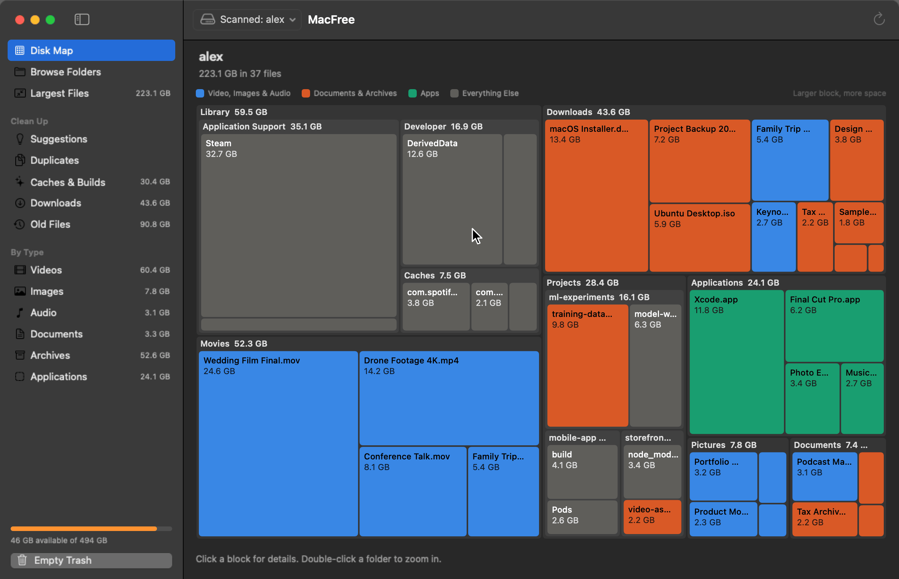

# MacFree

A free, open source Mac app that shows what's filling your disk and helps you clear it.

Developed by Diego Cibils.



## Features

- **Disk Map:** every folder and file drawn as a block sized by the space it uses. Double-click to zoom in.
- **Sorted lists:** largest files, caches and build files, downloads, old files, and files by type.
- **Sort and search:** by name, size, modified date, created date or kind, with a minimum size filter.
- **Suggestions:** the easiest places to start, like caches and old installers, with the space each would free.
- **Duplicates:** finds files with identical contents and suggests which copy to keep. App data, hidden folders and code projects are left out, because their copies are often needed.
- **Full app removal:** deleting an app can also remove its settings, caches and data from your Library.
- **Quick cleanup:** tick items anywhere in the app, see the running total, then delete them together.
- **Safe by default:** system files and key folders are locked, and every delete asks first. Moves to the Trash can be undone.
- **Private:** everything runs on your Mac, and iCloud files aren't downloaded during a scan.

## Install

1. Download `MacFree.zip` from the [latest release](https://github.com/dcibils-neuratek/macfree/releases/latest).
2. Unzip it and move `MacFree.app` to Applications.
3. Open it. macOS warns you because the app isn't notarized by Apple, so go to System Settings > Privacy & Security and choose Open Anyway.

Requires macOS 14 or later.

### Full Disk Access

Without this permission, macOS keeps some folders from being scanned and totals will be low. Add MacFree under System Settings > Privacy & Security > Full Disk Access, then scan again.

## Good to know

- Moving items to the Trash doesn't free space until the Trash is emptied. Use Delete Permanently or Empty Trash to get it back.
- Empty Trash clears everything in the Trash, not only what MacFree put there.
- Deleting a file synced with iCloud also removes it from your other devices. MacFree warns you first.

## Build from source

You need Xcode 16 or later, or its command line tools.

```bash
./scripts/build-app.sh
open build/MacFree.app
```

Run the tests with:

```bash
swift test
```

Launch with sample data, which is how the screenshots are made:

```bash
open build/MacFree.app --args --demo
```

Rebuild the website's screenshots and animated tour, which needs `ffmpeg`:

```bash
./scripts/make-tour.sh
```

## License

[MIT](LICENSE) © 2026 Diego Cibils
